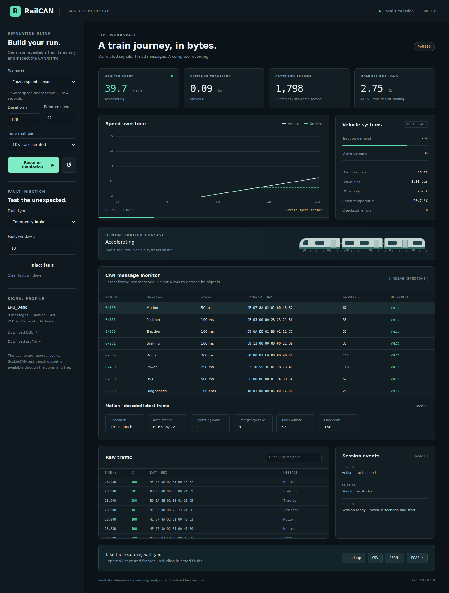

# RailCAN

**Generate CAN signals. Send them to real hardware. Prove what came out the other end.**

RailCAN is a dependency-free Python generator, monitor and verifier for Classical CAN traffic. It produces correlated train and engine telemetry, including SAE J1939 messages and DM1 diagnostics. It has a local dashboard, repeatable scenarios, timed fault injection and editable signal profiles. It can transmit through SocketCAN, python-can-compatible adapters or RailCAN's documented 13-byte CAN-over-IP transport. It can also receive and record live traffic, subscribe to an MQTT broker, and measure end-to-end loss and latency through a black-box telemetry pipeline.

The included `EMU_Demo` layout is synthetic. It is useful for parser development, dashboard demos, message monitoring, and isolated CAN test benches. It does not reproduce an OEM train protocol, implement CANopen, or claim IEC 61375 conformance.



## Quick start

Install **Python 3.10 or newer**, download or clone this project, and open a terminal in its folder:

```bash
python -m railcan ui
```

On Windows, you can also double-click **`start_windows.bat`**. On macOS use `python3 -m railcan ui`, or `start_macos.command`; on Linux use `./start.sh`.

The dashboard opens at **http://127.0.0.1:8765**. Choose a scenario and press **Start simulation**. Pause/resume preserves the capture; reset starts a new capture. Exports contain every frame captured in the current run, not just the visible frame log. Export a recording before resetting or closing the server; session captures are temporary.

If port 8765 is busy:

```bash
python -m railcan ui --port 8766
```

No CAN hardware, account, internet access, or third-party Python package is needed for the simulator and dashboard. The UI runs in your local browser; this release is Python software, not a bundled standalone executable.

## What it generates

| Message | CAN ID | Cycle | Signals |
|---|---:|---:|---|
| Motion | `0x100` | 50 ms | Speed, acceleration, operating mode, emergency brake |
| Position | `0x101` | 100 ms | Distance and target speed |
| Traction | `0x200` | 100 ms | Motor RPM, traction demand, motor temperature |
| Braking | `0x201` | 100 ms | Brake pipe/cylinder pressure, demand, parking/emergency flags |
| Doors | `0x300` | 200 ms | Left/right door masks, lock, interlock, obstruction, passengers |
| Power | `0x400` | 250 ms | DC supply, signed current, battery voltage |
| HVAC | `0x500` | 500 ms | Cabin/ambient temperature, HVAC mode, setpoint |
| Diagnostics | `0x600` | 1000 ms | Uptime and fault code |

The default profile emits **62 frames per simulated second**. Each frame has eight data bytes, an 8-bit alive counter, and a demonstrator XOR checksum. The default nominal bus load at 250 kbit/s is 2.753%; the estimate excludes bit stuffing, arbitration delays, retransmissions, and errors.

The train model cycles through station dwell, acceleration, cruising, and braking. Doors and traction are interlocked; speed, distance, RPM, brake demand, and current are related. Thermal behaviour is deliberately simplified. A seed makes the same run reproducible regardless of export format or wall-clock pacing.

## J1939 engine profile

```bash
python -m railcan profiles
python -m railcan simulate --profile j1939 --scenario multi_dtc --duration 60 --out engine.pcap
python -m railcan inspect engine.pcap --profile j1939
python -m railcan dbc --profile j1939 --out j1939.dbc
```

The built-in `j1939` profile broadcasts standard engine PGNs (EEC1, EEC2, LFE1, EFL/P1, ET1, HOURS, VEP1) with 29-bit IDs and 0xFF padding. It also sends DM1 active faults, using TP.BAM multi-packet transfer when more than one DTC is active, and a sequence-number probe on PGN 0xFF00 for end-to-end tracing. Scenarios `engine_overheat`, `low_oil_pressure` and `multi_dtc` drive the diagnostics. See [signal definitions](docs/SIGNALS.md).

Any profile can use waveform sources (`sine(0,100,10)`, `ramp`, `square`, `triangle`, `step`, `random`, `const`) and the `seq` counter instead of model values. That makes it quick to design test signals without writing code.

## Send to hardware and verify end to end

```bash
pip install "railcan[hardware]"     # only for python-can adapters

# Receive and record with a second node (it also ACKs the traffic).
railcan monitor -i pythoncan:pcan:PCAN_USBBUS2 --allow-hardware --profile j1939 --out bus.log

# Transmit, keeping a recording of frames accepted by the transmitting interface.
railcan simulate --profile j1939 -i pythoncan:pcan:PCAN_USBBUS1 --allow-hardware --duration 600 --out sent.log

# Compare.
railcan verify sent.log bus.log --profile j1939
```

Acceptance by the transmitting interface does not prove that a frame was acknowledged or observed on the physical bus. Use a second adapter as the independent on-bus reference capture. To test a whole CAN → gateway → edge → broker chain, record the broker side with `railcan mqtt-listen`. Then run `railcan verify sent.log received.jsonl --telemetry`. It reports delivery, missing blocks of data, duplicates, reordering, latency percentiles and value fidelity, with optional pass/fail thresholds. The step-by-step procedure, including how to check whether a device acknowledges traffic, is in [docs/TEST_BENCH.md](docs/TEST_BENCH.md).

## Record, decode, and replay

```bash
# Generate two minutes of normal service, quickly and offline.
python -m railcan simulate --duration 120 --seed 42 --out normal.log

# A Wireshark-readable SocketCAN PCAP.
python -m railcan simulate --scenario emergency_stop --out emergency.pcap

# Frozen sensor readings, with decoded signals in JSONL.
python -m railcan simulate --scenario sensor_fault --out sensor.jsonl

# Analyse gaps, checksum errors, and alive-counter anomalies.
python -m railcan inspect sensor.jsonl

# Convert or replay an existing recording.
python -m railcan replay normal.log --out normal.csv

# Export definitions for other CAN tools.
python -m railcan dbc --out railcan.dbc
```

Supported recordings: candump compact `.log`, `.csv`, `.jsonl`, and Classical SocketCAN `.pcap` (link type 227); 11-bit and 29-bit IDs. Replay accepts those formats, retains timestamps and payloads, and can optionally pace and transmit frames. CAN FD, RTR/error frames, BLF, ASC, and PCAPNG are outside this release.

## Journey and fault scenarios

`normal`, `depot`, `emergency_stop`, `door_obstruction`, `hvac_overheat`, `low_voltage`, `sensor_fault`, `message_dropout`, `checksum_error`, `counter_freeze`, `engine_overheat`, `low_oil_pressure` and `multi_dtc` are built in.

```bash
python -m railcan scenarios
python -m railcan simulate --duration 100 --faults examples/faults.json --out mixed.jsonl
```

The dashboard also injects finite faults into an active or paused session. The chart separates model speed from the on-wire speed reading, making sensor freezes and spikes visible. Fault injection alters the simulated state or data; it does not generate electrical CAN errors.

## Customise the train and signal layout

```bash
python -m railcan profile --out train-profile.json            # or --template j1939
# Edit train parameters, CAN IDs, cycles, scaling, or signal positions.
python -m railcan validate train-profile.json
python -m railcan ui --profile train-profile.json
python -m railcan simulate --profile train-profile.json --out custom.log
python -m railcan dbc --profile train-profile.json --out custom.dbc
```

Profiles use little-endian (Intel) signals. By default a message reserves byte 6 for an alive counter and byte 7 for a checksum. Set `"trailer": "none"` to use all 64 bits, as J1939 messages do. CAN IDs may be 11-bit or 29-bit, or given as a J1939 `pgn` with priority and source address. Message periods are multiples of the 10 ms simulation tick. Profile validation rejects overlaps, invalid ranges, unknown telemetry sources, duplicate IDs, and excessive nominal bus load. Actual model values must fit the signal's configured physical range; narrowing a range can make a run fail. Built-in frame faults target the `Motion` or `Traction` message names; custom faults can select another compatible message.

## Linux CAN test bench

SocketCAN output uses Linux's native CAN socket API; it has no Python dependency. Configure an interface yourself before transmitting. On Windows and macOS, use a `pythoncan:` interface or a network gateway instead (see [usage](docs/USAGE.md#can-interfaces)). Start with a virtual interface:

```bash
sudo modprobe vcan
sudo ip link add dev vcan0 type vcan
sudo ip link set vcan0 up

# In a separate terminal, if can-utils is installed:
candump vcan0

# Automatic wall-clock pacing when transmitting.
python -m railcan simulate --socketcan vcan0 --duration 30 --out bench.log
python -m railcan replay bench.log --socketcan vcan0
```

Physical interfaces, hardware python-can backends and non-loopback gateways require `--allow-hardware`. Use an isolated, authorised CAN test bench, with its bitrate and termination already configured. Do not transmit synthetic traffic onto an operational vehicle network. RailCAN passes the profile bitrate to python-can adapters but never reconfigures SocketCAN links itself. It does warn when a link's bitrate differs from the profile. Hardware compatibility depends on the selected python-can backend and vendor driver; physical adapters were not exercised for this release.

See [usage](docs/USAGE.md), [signal definitions](docs/SIGNALS.md), [test bench](docs/TEST_BENCH.md), and [architecture](docs/ARCHITECTURE.md) for details.

## Development

```bash
python -m unittest discover -s tests -v
python -m pip install -e .
railcan --help
```

Tests cover byte-level encoding, J1939 identifiers, DM1 and TP.BAM, waveforms, schedule counts, model invariants, deterministic seeds, timed faults, trace round trips, malformed inputs, replay, gateway and python-can transports, MQTT and MessagePack, end-to-end verification, local API controls, and export snapshots. GitHub Actions runs tests and builds the package on Linux and Windows. Actual adapter transmission needs a separate CAN test bench.

MIT licensed.
